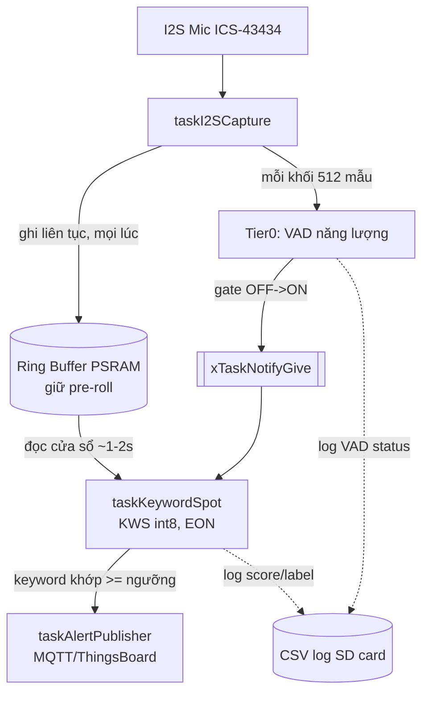
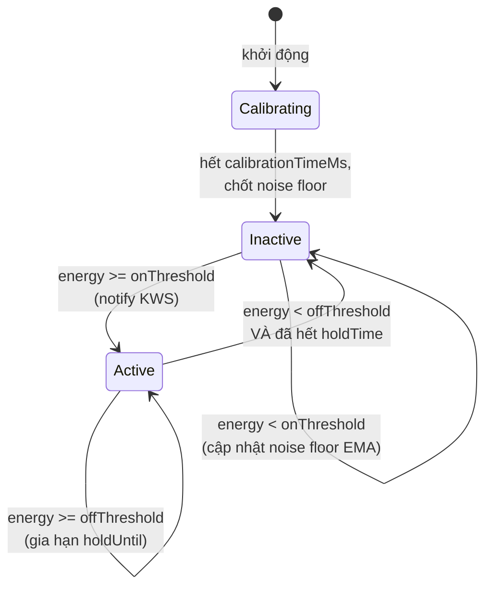

# Kiến trúc hệ thống 2 tầng phát hiện kêu cứu (ESP32-S3 + FreeRTOS)

> **Thay đổi so với phiên bản 3 tầng trước:** đã loại bỏ hoàn toàn tầng
> nhận diện tiếng hét chung (CNN scream/noise). Lý do: kiến trúc cascade
> AND (Tier1 gate Tier2) khiến recall tổng = recall(Tier1) × recall(Tier2)
> — nếu Tier1 không bắt được các trường hợp "cứu tôi" không phát ra theo
> kiểu hét điển hình, Tier2 không bao giờ có cơ hội chạy. Phương án OR
> (chạy song song 2 model) được cân nhắc nhưng bị loại vì làm tăng nguy
> cơ báo động giả (2 nguồn độc lập cùng có thể kích hoạt cảnh báo). Quyết
> định cuối: đơn giản hóa còn **VAD (lọc năng lượng) → KWS (nhận diện từ
> khóa, quantized int8)**.

---

## 1. Tổng quan 2 tầng

| Tầng | Vai trò | Độ nặng tính toán | Tần suất chạy |
|---|---|---|---|
| **Tier 0** | Lọc tiếng ồn / phát hiện năng lượng âm thanh (VAD) | Rất nhẹ (RMS trên từng khối mẫu) | Liên tục, mọi khối 512 mẫu (~32ms @16kHz) |
| **Tier 1** | Nhận diện từ khóa tiếng Việt ("cứu tôi", "cứu với") — KWS, **quantized int8** | Trung bình-nặng (KWS model, EON compiler) | Chỉ khi Tier 0 báo có tín hiệu (gate OFF→ON) |

> **Lưu ý đặt tên:** tầng KWS trước đây được gọi là "Tier 2" trong tài
> liệu 3 tầng. Vì giờ nó là tầng AI duy nhất còn lại, tài liệu này gọi nó
> là **Tier 1** cho nhất quán với số lượng tầng thực tế. Trong code, bạn
> có thể giữ nguyên tên file `tier2_keyword_spot.h/.cpp` (đỡ phải đổi tên
> và include path ở nhiều nơi) hoặc đổi thành `tier1_keyword_spot.h/.cpp`
> — chọn 1 trong 2 và **thống nhất xuyên suốt project**, đừng để lẫn cả
> hai cách gọi vì dễ gây nhầm lẫn khi đọc lại code sau này.

Nguyên tắc thiết kế không đổi: Tier0 đóng vai trò gác cổng rẻ tiền cho
Tier1 đắt tiền, để tránh chạy CNN/KWS liên tục 24/7 gây hao pin.



---

## 2. Danh sách Task FreeRTOS

| Task | Core | Priority | Stack size | Trạng thái nghỉ |
|---|---|---|---|---|
| `taskI2SCapture` | Core 0 | 5 (cao — realtime) | 4096 bytes | Blocking trên `i2s_read()` |
| `taskKeywordSpot` (KWS, int8) | Core 1 | 3 | 8192–16384 bytes | Blocking trên `ulTaskNotifyTake()` |
| `taskAlertPublisher` | Core 1 | 2 | 4096 bytes | Blocking trên `ulTaskNotifyTake()`/Queue |
| `taskSDLogger` (nếu tách riêng) | Core 0/1 | 2 | 4096 bytes | Blocking trên Queue |

Kiến trúc task tối giản hơn phiên bản 3 tầng: **bớt 1 task** (`taskTier1ScreamDetect`), bớt 1 lần chuyển tiếp notify, bớt 1 model cần load vào bộ nhớ — giảm cả độ phức tạp code lẫn dung lượng flash/PSRAM cần cho model.

---

## 3. Tác động của việc bỏ Tier1 lên tần suất chạy KWS

Đây là điểm quan trọng nhất cần lưu ý khi triển khai: **KWS giờ chạy trên MỌI sự kiện âm thanh vượt qua VAD**, không chỉ những sự kiện "giống tiếng hét" như trước. Nghĩa là:

- Nói chuyện bình thường gần mic, tiếng TV, tiếng nhạc có giọng hát... đều có thể kích hoạt VAD và gọi KWS chạy.
- **Tần suất gọi inference tăng lên đáng kể** so với kiến trúc cũ, ảnh hưởng trực tiếp tới:
  - **Tiêu thụ năng lượng** — cần đo lại thực tế, không dùng số liệu cũ.
  - **False positive rate của chính KWS** — vì KWS giờ phải tự gánh toàn bộ việc phân biệt "có từ khóa" vs "chỉ là nói chuyện/tiếng ồn" mà trước đây một phần được Tier1 hét lọc bớt phạm vi. Bù lại, hầu hết model KWS chuẩn (kể cả template Edge Impulse) đã có sẵn lớp `unknown`/`noise` được train riêng để xử lý đúng việc này, nên đây là điều model được thiết kế để làm, không phải gánh nặng bất ngờ.

**Khuyến nghị bắt buộc trước khi triển khai thực tế:**
1. **Quantize int8 (đã có trong quyết định của bạn)** — bắt buộc phải bật khi export từ Edge Impulse Studio (Deployment → chọn "Quantized (int8)", không chọn "Unoptimized (float32)"). Kết hợp EON Compiler để giảm thêm RAM/flash.
2. **Tăng `onMultiplier` của Tier0 VAD** nếu môi trường có nhiều giọng nói nền (ví dụ nơi đông người) — để giảm bớt số lần KWS bị gọi vì các cuộc nói chuyện bình thường không liên quan.
3. **Đo lại `inferenceTimeMs` và tần suất gọi thực tế** sau khi triển khai, để tính lại ngân sách năng lượng — xem mục 6.

---

## 4. Tài nguyên dùng chung (Shared Resources)

Không đổi so với phiên bản 3 tầng, chỉ bớt `tier2TaskHandle` (không cần nữa vì không có tầng kế tiếp sau KWS — KWS notify thẳng `alertPublisherTaskHandle`):

| Tài nguyên | Kiểu | Mục đích |
|---|---|---|
| `ringBufferMutex` | `SemaphoreHandle_t` | Bảo vệ ring buffer PSRAM giữa `taskI2SCapture` (ghi) và `taskKeywordSpot` (đọc) |
| Ring buffer PSRAM | Circular buffer, kích thước ≥ cửa sổ KWS + pre-roll | Giữ pre-roll để không mất phần đầu câu nói khi VAD vừa kích hoạt |
| `keywordTaskHandle` | `TaskHandle_t` | Tier0 gọi `xTaskNotifyGive()` đánh thức KWS trực tiếp |
| `alertPublisherTaskHandle` | `TaskHandle_t` | KWS gọi khi keyword khớp |

---

## 5. Luồng dữ liệu chi tiết theo từng bước

### Bước 1 — `taskI2SCapture` (không đổi logic, chỉ đổi đích notify)
```
loop:
  1. i2s_read() -> đọc 512 mẫu int32
  2. Convert int32 -> int16 (áp gain nếu cần)
  3. Lock ringBufferMutex -> ghi vào ring buffer -> Unlock (luôn ghi)
  4. gateActive = tier0_vad_process(pcmBuf, 512)
  5. Nếu gateActive vừa chuyển OFF -> ON: xTaskNotifyGive(keywordTaskHandle)
  6. goto loop
```

### Bước 2 — `taskKeywordSpot` (thay thế cả Tier1 lẫn Tier2 cũ)
```
loop:
  1. ulTaskNotifyTake(pdTRUE, portMAX_DELAY)
  2. while (tier0_vad_get_status().gateActive):
       a. Đọc cửa sổ audio (1-2s tuỳ window size model KWS) từ ring buffer
       b. Chạy run_classifier() (model KWS int8, EON)
       c. Nếu keywordScore >= KEYWORD_THRESHOLD VÀ label != "unknown"/"noise":
            xTaskNotifyGive(alertPublisherTaskHandle)
            (kèm label, score, timestamp)
       d. Ghi log vào CSV
  3. // Tier0 báo gate tắt -> quay lại chờ sự kiện tiếp theo
```

### Bước 3 — `taskAlertPublisher` (không đổi)
```
loop:
  1. ulTaskNotifyTake(pdTRUE, portMAX_DELAY)
  2. Đóng gói payload JSON (timestamp, label, score, device_id)
  3. Gửi MQTT/ThingsBoard
  4. goto 1
```

---

## 6. Bảng tham số cấu hình cần tinh chỉnh

| Tham số | File | Ý nghĩa | Giá trị khởi điểm | Ghi chú thay đổi |
|---|---|---|---|---|
| `onMultiplier` | `tier0_vad_gate.h` | Ngưỡng bật gate | 3.0 | **Cân nhắc tăng** (ví dụ 3.5-4.0) so với bản 3 tầng, vì giờ mỗi lần gate bật đều tốn 1 lần KWS chạy trực tiếp, không còn Tier1 lọc bớt |
| `offMultiplier` | `tier0_vad_gate.h` | Ngưỡng tắt gate | 1.5 | Không đổi |
| `holdTimeMs` | `tier0_vad_gate.h` | Giữ gate mở qua khoảng ngắt quãng | 400ms | Có thể cần tăng nhẹ nếu câu "cứu tôi/cứu với" phát âm chậm hơn tiếng hét ngắn |
| `minNoiseFloor` | `tier0_vad_gate.h` | Sàn tối thiểu | 50.0 | Đo lại tại nơi lắp đặt thật |
| `KEYWORD_THRESHOLD` | integration code | Ngưỡng confidence coi là khớp từ khóa | 0.80 (đề xuất giữ hoặc tăng nhẹ) | Vì KWS giờ là tuyến phòng thủ DUY NHẤT chống false positive, nên **test kỹ trên tập validation** trước khi chốt — đây là tham số quan trọng nhất trong kiến trúc mới |
| Quantization | Edge Impulse Deployment | int8 + EON | Bắt buộc bật | Đã quyết định — kiểm tra lại đúng "Quantized (int8)" khi export, không phải "float32" |

---

## 7. Ngân sách thời gian & năng lượng (cần đo lại)

| Giai đoạn | Ghi chú |
|---|---|
| Đọc 1 khối I2S | ~32ms, không đổi |
| Tier0 xử lý 1 khối | <1ms, không đổi |
| **Tần suất gọi KWS** | **TĂNG so với bản 3 tầng** — cần đo thực tế bằng cách đếm số lần `taskKeywordSpot` được đánh thức trong 1 khoảng thời gian ở môi trường thật (có người nói chuyện bình thường xung quanh) |
| KWS inference (int8, EON) | Đo bằng `inferenceTimeMs` có sẵn trong wrapper — nếu quá lâu, cân nhắc giảm kích thước window hoặc kiến trúc model nhẹ hơn (ví dụ giảm số layer/filter trong Edge Impulse Studio) |
| Dòng điện trung bình | **Phải đo lại từ đầu** — không dùng số liệu ước tính từ kiến trúc 3 tầng cũ, vì tần suất chạy AI đã thay đổi đáng kể |

---

## 8. Trình tự khởi tạo trong `setup()`

```
setup():
  1. Serial.begin(...)
  2. i2s_init()
  3. sd_init()
  4. initFromExistingFiles()
  5. Khởi tạo ring buffer PSRAM + ringBufferMutex
  6. tier0_vad_init(vadConfig)
  7. keywordSpot_init()   // trước đây là tier2_init()
  8. Tạo task theo chiều ngược luồng dữ liệu (đích trước, nguồn sau):
       xTaskCreatePinnedToCore(taskAlertPublisher, ..., core=1)
       xTaskCreatePinnedToCore(taskKeywordSpot, ..., core=1)
       xTaskCreatePinnedToCore(taskI2SCapture, ..., core=0)
```

---

## 9. Sơ đồ trạng thái Tier0 Gate (không đổi)



---

## 10. Checklist kiểm thử & tinh chỉnh trước khi triển khai thực tế

- [ ] Xác nhận model KWS export từ Edge Impulse đã chọn **Quantized (int8)**, không phải float32
- [ ] Đo noise floor thực tế tại vị trí lắp đặt bằng lệnh `p`
- [ ] Đo **tần suất gọi KWS thực tế** trong môi trường có người nói chuyện bình thường xung quanh (không phải kêu cứu) — đây là chỉ số mới quan trọng nhất so với kiến trúc cũ
- [ ] Test riêng KWS với các mẫu "nói chuyện bình thường không chứa từ khóa" để đo false positive rate — vì giờ không còn Tier1 lọc bớt, false positive của KWS ảnh hưởng trực tiếp đến toàn hệ thống
- [ ] Test với các biến thể cách nói "cứu tôi"/"cứu với" (giọng hét, giọng gấp gáp bình thường, giọng nghẹn/yếu) để xác nhận vấn đề recall ban đầu đã được giải quyết
- [ ] Đo `inferenceTimeMs` thực tế trên phần cứng, đảm bảo độ trễ end-to-end (VAD kích hoạt → cảnh báo) chấp nhận được
- [ ] Đo dòng điện tiêu thụ thực tế TRƯỚC và SAU khi bỏ Tier1, so sánh với kiến trúc 3 tầng cũ — xác nhận việc bỏ Tier1 không làm tăng tiêu thụ điện vượt ngoài dự kiến do KWS chạy thường xuyên hơn
- [ ] Kiểm tra memory: bớt 1 model Edge Impulse giúp giải phóng flash/PSRAM — có thể tận dụng phần dư ra để tăng kích thước ring buffer (pre-roll dài hơn) nếu cần
- [ ] Test end-to-end bằng `concat_dataset.py` (phát qua loa, thu lại bằng mic), đo recall/precision tổng thể của hệ thống 2 tầng mới, so sánh với số liệu hệ thống 3 tầng cũ để xác nhận cải thiện

---

## 11. Cấu trúc thư mục source code

```
src/
  main.cpp
  capture/
    i2s_capture_task.cpp/.h
  tier0/
    tier0_vad_gate.cpp/.h
  keyword_spot/                  // trước đây là tier2/, đổi tên cho khớp vai trò mới
    keyword_spot.cpp/.h          // trước đây là tier2_keyword_spot.cpp/.h
  alert/
    alert_publisher_task.cpp/.h
  ringbuffer/
    ring_buffer.cpp/.h
lib/
  keyword_spot_model/            // Edge Impulse C++ lib (int8), chỉ còn 1 model
```

**Việc cần dọn dẹp khi migrate từ 3 tầng sang 2 tầng:**
- Xóa `tier1_scream_detect.h`/`tier1_scream_detect.cpp`
- Xóa thư mục `lib/tier1_model/` (thư viện Edge Impulse Tier1)
- Xóa hàm `taskTier1ScreamDetect` khỏi `main.cpp`
- Xóa `tier1TaskHandle`, `TIER1_SCREAM_THRESHOLD`
- Trong `taskI2SCapture`, đổi `xTaskNotifyGive(tier1TaskHandle)` thành `xTaskNotifyGive(keywordTaskHandle)` (notify thẳng tới KWS thay vì Tier1)
