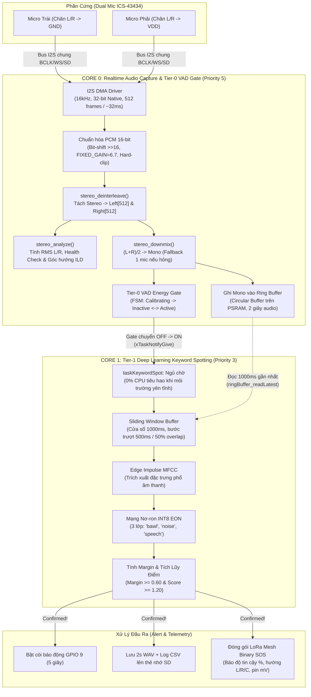

# 🎙️ Kiến Trúc Toàn Bộ Luồng Xử Lý Âm Thanh (Audio Processing Pipeline)

Tài liệu này trình bày chi tiết và toàn diện kiến trúc **2 tầng phân cấp (Two-Tier Hierarchical Pipeline)** cùng luồng xử lý tín hiệu âm thanh nhận diện tiếng kêu cứu trên chip vi điều khiển **ESP32-S3** trong hệ thống cứu nạn LoRa Mesh.

---

## 🗺️ 1. Sơ Đồ Khối Tổng Thể & Phân Phối Nhân FreeRTOS

Hệ thống tận dụng tối đa kiến trúc vi xử lý lõi kép (Dual-core Xtensa LX7 240MHz) của ESP32-S3 để phân chia tác vụ xử lý âm thanh thời gian thực và suy luận trí tuệ nhân tạo (AI):



---

## 🎙️ 2. Tầng Thu Nhận Tín Hiệu & Tiền Xử Lý (Core 0)

Tác vụ `taskI2SCapture` được ghim vào **Core 0** với mức ưu tiên rất cao (`Priority 5`), chạy liên tục để đọc dữ liệu âm thanh từ phần cứng không bị gián đoạn.

### 2.1. Cấu hình phần cứng I2S & Dual MEMS Mic
* **Phần cứng**: 02 micro kỹ thuật số MEMS **ICS-43434** chia sẻ chung một cổng bus I2S:
  * Chân `L/R` của Mic Trái nối **GND** $\rightarrow$ Dữ liệu xuất hiện khi xung chọn kênh `WS` ở mức **LOW**.
  * Chân `L/R` của Mic Phải nối **VDD (3.3V)** $\rightarrow$ Dữ liệu xuất hiện khi `WS` ở mức **HIGH**.
* **Thông số lấy mẫu (Sampling Parameters)**:
  * Tần số lấy mẫu: $16.000\text{ Hz}$ ($16\text{ kHz}$) — đáp ứng dải tần số giọng nói con người ($0 - 8\text{ kHz}$).
  * Chiều rộng mẫu phần cứng: $32\text{-bit}$ (I2S Native).
  * Bộ đệm DMA: Gồm $8\text{ descriptors} \times 1024\text{ bytes}$. Mỗi chu kỳ đọc $512\text{ frames}$ stereo ($1024\text{ mẫu int32}$ xen kẽ $L_0, R_0, L_1, R_1,...$), tương ứng một khối dữ liệu kéo dài đúng **$32\text{ ms}$**.

### 2.2. Chuẩn hóa biên độ & Hệ số Gain cố định (Fixed Gain)
* Chuyển đổi định dạng từ 32-bit DMA native sang 16-bit PCM:
  $$\text{raw} = (\text{int16\_t})(i2sBuf[i] \gg 16)$$
* **Hệ số khuếch đại cố định (`FIXED_GAIN = 6.7f`)**:
  $$\text{amplified} = \text{raw} \times 6.7$$
  > [!NOTE]
  > Hệ thống **hoàn toàn không dùng AGC (Automatic Gain Control)** nhằm giữ nguyên vẹn đường bao năng lượng và đặc trưng động học của âm thanh thực tế, giúp mô hình AI phân loại chuẩn xác.
* **Hard-clipping**: Giới hạn trong khoảng biểu diễn số nguyên 16-bit $[-32768, +32767]$ để chống tràn số âm học (audio overflow distortion).

---

## 🎧 3. Tách Kênh Stereo, Tự Phục Hồi & Ước Lượng Hướng (Stereo Processing)

### 3.1. Tách kênh xen kẽ (Deinterleaving)
Khối $1024\text{ mẫu}$ được phân tách độc lập thành:
* `leftBuf[512]`: Tín hiệu kênh trái.
* `rightBuf[512]`: Tín hiệu kênh phải.

### 3.2. Downmix Thích Ứng & Cơ Chế Dự Phòng (Fault-Tolerant Downmix)
* **Chế độ bình thường**: Hai kênh được cộng trung bình để tạo tín hiệu mono:
  $$mono[i] = \frac{left[i] + right[i]}{2}$$
  Việc cộng pha hai kênh độc lập giúp **tăng tỷ số tín hiệu trên nhiễu (SNR) lên khoảng $3\text{ dB}$**, đồng thời làm suy giảm nhiễu nền ngẫu nhiên của môi trường.
* **Cơ chế tự phục hồi (Self-Healing Fallback)**:
  * Hàm `stereo_analyze()` liên tục tính $RMS$ năng lượng từng kênh:
    $$RMS = \sqrt{\frac{1}{N}\sum_{i=0}^{N-1} s_i^2}$$
  * Nếu tỷ số $\frac{\max(RMS_L, RMS_R)}{\min(RMS_L, RMS_R)} > 5.0$ liên tục qua **$100\text{ khối}$ ($~3.2\text{ giây}$)**:
    - Hệ thống phát hiện 1 micro bị lỗi hoặc bị dị vật/nước che lấp.
    - Tự động chuyển chế độ bypass: **chỉ dùng micro lành lặn** để làm tín hiệu mono cho AI, ngăn ngừa tình trạng trạm giám sát bị hỏng hoàn toàn.

### 3.3. Ước lượng hướng nguồn âm dựa trên chênh lệch biên độ (ILD)
Với khoảng cách 2 micro bố trí cách nhau $~9\text{ cm}$, hệ thống đo đạc mức chênh lệch áp suất âm thanh giữa hai tai (**Interaural Level Difference - ILD**):
$$ILD_{\text{dB}} = 20 \cdot \log_{10}\left(\frac{RMS_{\text{Left}}}{RMS_{\text{Right}}}\right)$$
* Nếu $ILD_{\text{dB}} > +2.0\text{ dB}$: Nguồn âm thanh phát ra từ bên **Trái (LEFT)**.
* Nếu $ILD_{\text{dB}} < -2.0\text{ dB}$: Nguồn âm thanh phát ra từ bên **Phải (RIGHT)**.
* Nếu $|ILD_{\text{dB}}| \le 2.0\text{ dB}$: Nguồn âm ở vị trí **Chính diện (CENTER)** hoặc từ khoảng cách xa.

---

## 🗄️ 4. Bộ Đệm Vòng Trên PSRAM (Ring Buffer Pre-Roll)

* **Vị trí bộ nhớ**: Được cấp phát trên bộ nhớ ngoài **PSRAM** với dung lượng $32.000\text{ mẫu}$ (tương ứng **$2.0\text{ giây}$ âm thanh mono @16kHz**, kích thước $64\text{ KB}$).
* **Ghi liên tục không dừng (Always-Recording)**: `taskI2SCapture` ghi đè xoay vòng liên tục dữ liệu mono vào Ring Buffer bất kể cổng VAD Gate đang mở hay đóng.
* **Vai trò tiền tố (Pre-roll Buffer)**: Khi nạn nhân bắt đầu cất tiếng kêu cứu, âm thanh thường khởi đầu bằng âm tiết nhỏ trước khi đạt đỉnh. Nhờ có bộ đệm vòng 2 giây, khi VAD Gate kích hoạt mở, mô hình AI có thể đọc ngược lại đoạn âm thanh của 1 giây trước đó, **bảo toàn trọn vẹn toàn bộ câu từ khóa**, triệt tiêu hiện tượng "cắt cụt âm đầu".

---

## 🚪 5. Tầng 0: Cổng Năng Lượng Âm Thanh Thích Ứng (Tier-0 VAD Gate)

Mô hình học sâu Deep Learning tiêu hao năng lượng và chu kỳ CPU rất lớn. Cổng VAD Gate đóng vai trò như bộ lọc ngưỡng năng lượng thông minh, đưa tác vụ AI vào trạng thái ngủ đông khi rừng núi yên tĩnh.

Cổng VAD hoạt động theo cỗ máy trạng thái (FSM) gồm 3 chế độ:

```
                  ┌──────────────┐
                  │ CALIBRATING  │ (Đo noise floor 2000ms khi khởi động)
                  └──────┬───────┘
                         │
                         ▼
           ┌───────────────────────────┐
           │         INACTIVE          │◄───────────────────────┐
           │ (Gate OFF - AI đang ngủ)  │                        │
           └─────────────┬─────────────┘                        │
                         │                                      │
           RMS >= 3.0 * NoiseFloor                              │
           (xTaskNotifyGive đánh thức AI)                       │
                         │                                      │
                         ▼                                      │
           ┌───────────────────────────┐                        │
           │          ACTIVE           │                        │
           │ (Gate ON - AI trượt mẫu)  ├────────────────────────┘
           └───────────────────────────┘  1. RMS < 1.5 * NoiseFloor VÀ hết Hold-time (400ms)
                                          2. Hoặc kẹt quá 30 giây (Max Active Timeout)
```

1. **Giai đoạn hiệu chuẩn (CALIBRATING - 2000ms)**:
   * Khi khởi động, hệ thống dành 2 giây để tính trung bình năng lượng nền môi trường, thiết lập mức sàn nhiễu cơ sở (`noiseFloor`).
2. **Giai đoạn không hoạt động (INACTIVE - Gate OFF)**:
   * Cập nhật sàn nhiễu liên tục bằng bộ lọc trung bình trượt hàm mũ (EMA):
     $$NoiseFloor_{\text{new}} = (1 - \alpha) \cdot NoiseFloor_{\text{old}} + \alpha \cdot RMS \quad (\alpha = 0.01)$$
   * Khi phát hiện năng lượng vượt ngưỡng bật:
     $$RMS \ge NoiseFloor \times 3.0 \quad (\text{VAD\_ON\_MULTIPLIER} = 3.0)$$
   * $\rightarrow$ Chuyển trạng thái sang **ACTIVE**, gửi tín hiệu ngắt nhẹ FreeRTOS `xTaskNotifyGive(kwsTaskHandle)` đánh thức tác vụ AI trên Core 1.
3. **Giai đoạn hoạt động (ACTIVE - Gate ON)**:
   * **Hold-Time ($400\text{ ms}$)**: Gia hạn giữ cổng mở thêm $400\text{ ms}$ mỗi khi năng lượng đạt $\ge 1.5 \times NoiseFloor$ để nối liền các quãng ngắt nhịp thở tự nhiên giữa các lần la hét.
   * **Slow EMA ($\alpha_{\text{slow}} = 0.001$)**: Trong lúc Gate mở, nếu năng lượng rơi vào khoảng lặng ngắt câu, bộ lọc vẫn học sàn nhiễu với tốc độ chậm gấp 10 lần nhằm thích nghi với tiếng gió rừng biến thiên.
   * **Chống kẹt Gate vĩnh viễn (Max Active Timeout = $30\text{ s}$)**: Nếu âm thanh lớn liên tục quá 30 giây (tiếng suối xiết, ve sầu râm ran, máy bay tuần tra...), hệ thống tự động ép Gate đóng và đồng hóa mức năng lượng này thành sàn nhiễu mới, giải phóng CPU.

---

## 🧠 6. Tầng 1: Suy Luận AI Nhận Diện Tiếng Kêu Cứu (Tier-1 KWS - Core 1)

Tác vụ `taskKeywordSpot` chạy trên **Core 1** với mức ưu tiên `Priority 3`, sử dụng mô hình học sâu INT8 được tối ưu hóa bằng công nghệ **Edge Impulse EON Compiler**.

### 6.1. Cửa sổ trượt (Sliding Window Pipeline)
* **Khối đầu tiên**: Khi vừa nhận thông báo thức giấc, tác vụ đọc ngay $16.000\text{ mẫu}$ gần nhất từ Ring Buffer ($1000\text{ ms}$ âm thanh) để thực hiện suy luận.
* **Các khối tiếp theo**: Cửa sổ trượt tịnh tiến theo bước $500\text{ ms}$ (`KWS_SLIDE_MS = 500`, tỷ lệ gối đầu overlap $50\%$):
  * Dùng hàm `memmove` dịch chuyển nửa sau (8000 mẫu cũ) lên nửa đầu.
  * Gọi `ringBuffer_readLatest` đọc thêm $8.000\text{ mẫu}$ mới nhất vào nửa sau.
  * Tần suất thực thi suy luận đạt **$2\text{ lần / giây}$**.

### 6.2. Trích xuất đặc trưng & Mạng nơ-ron
1. **Khối DSP MFCC (Mel-Frequency Cepstral Coefficients)**:
   * Chuyển đổi tín hiệu miền thời gian sang miền tần số Log-Mel, tập trung phân tích dải tần số đặc trưng của tiếng la hét từ $1\text{ kHz} - 4\text{ kHz}$.
2. **Mô hình Mạng Nơ-ron Quantized INT8**:
   * Tính toán và xuất xác suất cho 3 nhãn phân loại:
     * $P_{\text{bawl}}$: Tiếng la khóc / gào thét / kêu cứu khẩn cấp.
     * $P_{\text{speech}}$: Tiếng người nói chuyện thông thường.
     * $P_{\text{noise}}$: Tiếng ồn môi trường tự nhiên (gió, lá cây, suối,...).

### 6.3. Thuật toán xác nhận Margin kết hợp Tích Lũy Điểm (Score Accumulation FSM)
Nhằm triệt tiêu triệt để hiện tượng dương tính giả (False Positive) từ tiếng chim hót, thú rừng hoặc tiếng cành cây gãy trong môi trường tự nhiên, hệ thống kết hợp 3 lớp bảo vệ đa tầng:

1. **Độ chênh lệch biên độ (Margin Difference)**:
   $$\text{Margin} = P_{\text{bawl}} - \max(P_{\text{noise}}, P_{\text{speech}})$$
   * **Ngưỡng biên độ khắt khe**: $\text{Margin} \ge 0.60$ (đảm bảo $P_{\text{bawl}}$ hoàn toàn vượt trội so với cả nhiễu nền và giọng nói đàm thoại, loại bỏ trường hợp model phân vân).

2. **Cơ chế tích lũy điểm tin cậy (Confidence Score Accumulation)**:
   * Khi $\text{Margin} \ge 0.60$, hệ thống chuyển từ `DETECT_IDLE` sang `DETECT_CANDIDATE` và cộng dồn điểm tin cậy:
     $$\text{accumulatedScore} \mathrel{+}= P_{\text{bawl}}$$
   * **Ngưỡng điểm kích hoạt**: $\text{accumulatedScore} \ge 1.20$. Yêu cầu ít nhất 2 khung phân tích liên tiếp đạt điểm cao ($\approx 0.80 - 0.90$) hoặc 3 khung đạt chuẩn.
   * **Thời lượng tối thiểu liên tục**: $\text{candidateDurMs} \ge 500\text{ ms}$ (tối thiểu qua 1 bước trượt $500\text{ ms}$).

3. **Cơ chế Fast-Reject (Triệt tiêu quán tính nhiễu)**:
   * Nếu tại bất kỳ khung nào trong giai đoạn `CANDIDATE` mà $\text{Margin} < 0.60$, máy trạng thái sẽ **reset ngay lập tức** về `IDLE` và xóa sạch điểm tích lũy:
     $$\text{accumulatedScore} = 0.0$$
   * Nhờ đó, các tiếng động ngẫu nhiên rải rác theo thời gian không bao giờ có thể cộng dồn điểm để gây báo động giả.

4. **Xác nhận kích hoạt & Cooldown Lockout**:
   * Khi thỏa mãn đồng thời $\text{accumulatedScore} \ge 1.20$ và $\text{candidateDurMs} \ge 500\text{ ms} \rightarrow$ Chuyển trạng thái sang **`CONFIRMED`**.
   * **Thời gian khóa chống lặp (Cooldown Lockout = 5000ms)**: Sau khi phát hiện thành công, hệ thống khóa nhận diện đúng trong 5 giây, bằng đúng thời gian còi hú cảnh báo tại chỗ để tránh micro thu lại tiếng còi gây lặp vòng lặp vô tận.

---

## 🚨 7. Xử Lý Sau Kích Hoạt (Output & LoRa Mesh Transmission)

Khi tiếng kêu cứu được xác nhận là `CONFIRMED`:

1. **Hú còi cảnh báo tại chỗ**:
   * Kích hoạt chân `ALARM_PIN` (GPIO 9) kéo còi hú liên tục trong **$5\text{ giây}$** (đồng bộ chính xác bằng thời gian Cooldown Lockout $5000\text{ ms}$) để báo hiệu cho nạn nhân biết thiết bị đã tiếp nhận thành công.
2. **Lưu trữ kiểm chứng lên thẻ nhớ SD**:
   * Ghi log sự kiện vào file CSV: `/recordings/detection_log.csv`.
   * Trích xuất nguyên vẹn file âm thanh WAV chất lượng cao $2\text{ giây}$ từ Ring Buffer lưu vào thư mục `/detections/det_xxxx.wav` để phục vụ công tác đối soát hiện trường và huấn luyện lại mô hình AI.
3. **Phát sóng LoRa Mesh SOS khẩn cấp**:
   * Đóng gói bản tin nhị phân siêu nén $7\text{ bytes}$ gồm:
     * Loại cảnh báo: `ALERT_BAWL`.
     * Độ tin cậy AI: $0 - 100\%$.
     * Hướng âm thanh ước lượng từ ILD: `DIR_LEFT`, `DIR_RIGHT` hoặc `DIR_CENTER`.
     * Mức điện áp pin hiện tại (mV).
   * Phát sóng đa chặng qua mạng lưới LoRa Mesh với cờ `PKT_FLAG_ACK_REQ` yêu cầu Gateway trả lời ACK xác nhận thành công.

---

## 📊 8. Bảng Tổng Hợp Thông Số Kỹ Thuật Toàn Bộ Pipeline

| Khâu xử lý | Thông số kỹ thuật | Ý nghĩa & Vai trò |
| :--- | :--- | :--- |
| **Micro Sampling** | $16.000\text{ Hz}$, $32\text{ bit}$ Native $\rightarrow 16\text{ bit}$ PCM | Đảm bảo băng thông dải âm thanh giọng nói ($0 - 8\text{ kHz}$) |
| **Độ lợi âm thanh** | $\text{Fixed Gain} = 6.7$ (Không AGC) | Giữ nguyên tỷ lệ động năng lượng âm thanh cho AI |
| **Kích thước khối I2S**| $512\text{ frames} = 32\text{ ms}$ audio | Cân bằng giữa độ trễ xử lý và overhead ngắt FreeRTOS |
| **Ring Buffer** | $32.000\text{ mẫu} = 2.0\text{ giây}$ trên PSRAM | Pre-roll buffer lưu trữ âm thanh trước khi VAD mở cổng |
| **Ngưỡng VAD Bật/Tắt**| $\text{On} = 3.0 \times \text{Noise}$, $\text{Off} = 1.5 \times \text{Noise}$ | Tránh chập chờn cổng (Hysteresis effect) |
| **Hold Time VAD** | $400\text{ ms}$ | Giữ cổng mở qua khoảng ngừng thở giữa các tiếng kêu |
| **KWS Window** | $1000\text{ ms}$ ($16.000\text{ mẫu}$), Slide $500\text{ ms}$ | Cửa sổ trượt phân tích ngữ cảnh của mô hình Deep Learning |
| **Ngưỡng Margin KWS**| $\text{Margin} \ge 0.60$ ($P_{\text{bawl}} - \max(P_{\text{noise}}, P_{\text{speech}})$) | Triệt tiêu triệt để báo động giả từ chim muông/gió bão |
| **Tích lũy điểm Score**| $\ge 1.20$ ($\sum P_{\text{bawl}}$ liên tục) | Yêu cầu ít nhất 2 khung liên tiếp độ tin cậy cao mới kích hoạt |
| **Thời gian còi tại chỗ**| $5000\text{ ms}$ ($5\text{ giây}$) | Báo hiệu cho nạn nhân, tự động ngắt còi sau 5s |
| **Cooldown Lockout**| $5000\text{ ms}$ ($5\text{ giây}$) | Khóa nhận diện trong thời gian hú còi để tránh tự kích hoạt |

